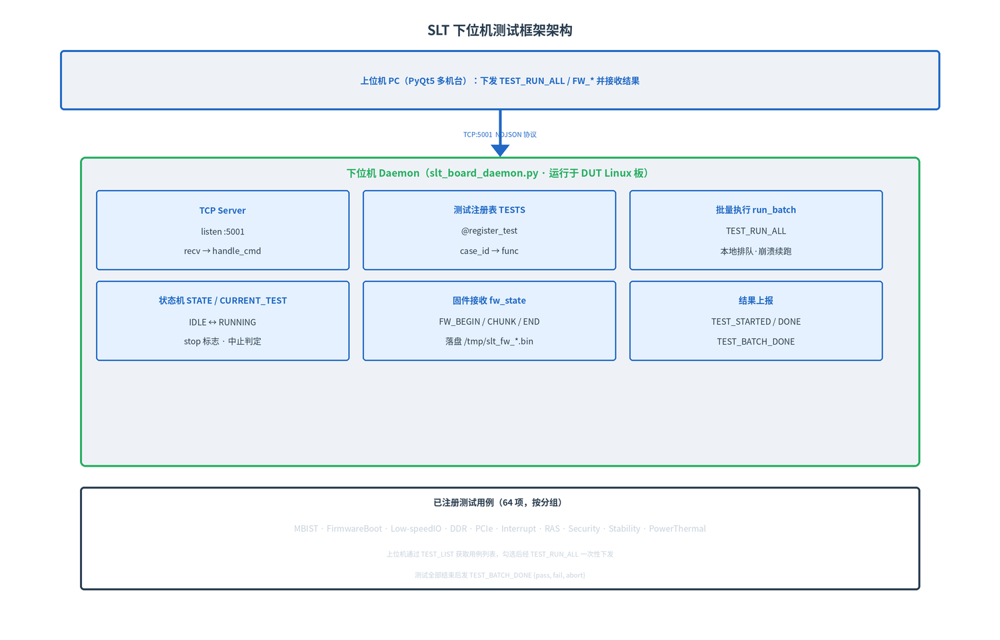

# SLT 下位机测试框架文档

## 1. 概述

下位机测试框架即 `slt_board_daemon.py`，运行在 **DUT 测试板（Linux）** 上，作为 TCP 服务器监听 `0.0.0.0:5001`，负责**实际执行芯片 SLT 测试用例**并把结果回传给上位机。

设计要点：
- **注册表驱动**：测试用例通过 `@register_test` 装饰器注册，新增用例只需加一个函数，无需改动框架代码。
- **批量执行**：上位机一次性下发整套用例（`TEST_RUN_ALL`），下位机本地排队跑到底，**即使上位机崩溃断连也继续执行**。
- **固件烧录**：支持分块接收固件（`FW_BEGIN/FW_CHUNK/FW_END`）并落盘。
- 单连接、顺序执行、`stop` 标志协同，保证并发安全。

## 2. 架构



| 模块 | 职责 |
|------|------|
| TCP Server | 监听 5001，按 `\n` 分隔读取 NDJSON 命令并分发到 `handle_cmd` |
| 测试注册表 `TESTS` | `case_id -> {func, desc}`，由 `@register_test` 填充 |
| 批量执行 `run_batch` | 顺序执行用例，收集 pass/fail/abort，最后发 `TEST_BATCH_DONE` |
| 状态机 `STATE / CURRENT_TEST` | 全局运行状态、当前用例、`stop` 中止标志 |
| 固件接收 `fw_state` | 固件会话缓冲，接收数据块、校验并落盘 |
| 结果上报 | 逐用例 `TEST_STARTED/TEST_PROGRESS/TEST_DONE`，整批 `TEST_BATCH_DONE` |

## 3. 核心机制

### 3.1 用例注册

```python
@register_test("MBIST_N3", "N3 core BIST")
def test_mbist_n3(progress_cb):
    progress_cb(50, "N3 BIST...")
    time.sleep(0.3)
    return True, "0x0000"     # (ok, err)  err: 0x0000 通过，其他为错误码
```

- `case_id` 必须全局唯一，上位机测试树中的叶子节点与之对应。
- 测试函数接收一个 `progress_cb(pct, msg)`，用于上报进度。
- 函数内通过 `CURRENT_TEST["stop"]` 判断是否被中止。

### 3.2 执行与中止

- 单个用例 `_execute_case`：置 `RUNNING` → 发 `TEST_STARTED` → 调 `func(progress_cb)` → 发 `TEST_DONE`。
- 异常被捕获：测试函数抛异常 → 结果记为 `FAIL`，错误码 `0xFFFF`。
- `TEST_STOP` 设 `stop` 标志：当前用例返回 `ABORT`，批量队列中剩余用例全部记为 `abort`。
- 同一时刻只跑一个测试线程（`CURRENT_TEST["running"]` 忙检查），避免并发冲突。

### 3.3 崩溃续跑

`TEST_RUN_ALL` 把整套用例**一次性下发**到本地队列，由 `run_batch` 排队执行。上位机中途断开/崩溃不会中断下位机，剩余用例照常跑完，结果在断连前尽力回传。

## 4. 通信协议

命令与响应均为单行 NDJSON。详细定义见 `slt_protocol.md`，这里列出框架支持的完整命令：

| PC → Board | 字段 | 说明 |
|------------|------|------|
| `PING` | — | 心跳 |
| `TEST_LIST` | — | 查询用例列表 |
| `TEST_START` | `case` | 执行单个用例 |
| `TEST_RUN_ALL` | `cases[]` | **批量下发整套用例** |
| `TEST_STOP` | — | 中止当前 + 剩余队列 |
| `GET_STATUS` | — | 查询状态 |
| `FW_BEGIN` | `file_type,size,sha256,version` | 开始固件会话 |
| `FW_CHUNK` | `offset,data(base64)` | 固件数据块 |
| `FW_END` | — | 结束并校验落盘 |

| Board → PC | 说明 |
|------------|------|
| `PONG` / `TEST_LIST_RSP` | 心跳 / 用例列表 |
| `TEST_STARTED` / `TEST_PROGRESS` / `TEST_DONE` | 逐用例生命周期 |
| `TEST_BATCH_DONE {pass,fail,abort}` | 整批结束统计 |
| `STATUS_RSP` | 状态查询响应 |
| `FW_READY` / `FW_CHUNK_OK` / `FW_DONE` / `FW_ERROR` | 固件流程响应 |

## 5. 固件烧录

- 上位机按 **8KB** 分块发送，`FW_BEGIN` 带文件类型/总字节数/`sha256`，下位机建会话。
- 每块 `FW_CHUNK` 按 `offset` 写入缓冲，回 `FW_CHUNK_OK`。
- `FW_END` 校验字节数与声明一致后落盘到 **`/tmp/slt_fw_<file_type>.bin`**，回 `FW_DONE`。
- 固件会话与测试串行（同一连接），不影响测试。

## 6. 已注册测试用例（64 项）

| 分组 | 用例 ID | 数量 |
|------|---------|------|
| MBIST 内存自检 | MBISR_CCD_SOC_HN, MBIST_CCD_SOC_HN, MBISR_N3, MBIST_N3, MBISR_PCD, MBIST_PCD | 6 |
| Firmware Boot | FW_RSS, FW_SCP, FW_MCP, FW_BBL14, FW_BL31, FW_UEFI, FW_SECURE, FW_LINUX | 8 |
| Low-speed IO | IO_MHU, IO_UART, IO_I2C, IO_I3C, IO_ESPI, IO_GPIO | 6 |
| DDR | DDR_BENCH, DDR_STRESS, DDR_EYE, DDR_ECC, DDR_PWR, DDR_RESET, DDR_CROSS, DDR_TIMING, DDR_BURNIN, DDR_TRAIN, DDR_DIMM, DDR_VOLT | 12 |
| PCIe | PCIE_LINK, PCIE_BW, PCIE_STRESS, PCIE_AER, PCIE_INTR, PCIE_ASPM, PCIE_HOTPLUG, PCIE_CFG | 8 |
| Interrupt | IRQ_PPI, IRQ_SGI, IRQ_SPI, IRQ_LPI, IRQ_GIC_C2C, IRQ_GIC_S2S, IRQ_VSGI, IRQ_VLPI | 8 |
| RAS | RAS_CMN, RAS_GIC, RAS_CORE, RAS_PCIE, RAS_UCIE, RAS_DDR, RAS_SMMU | 7 |
| Security | SEC_RUNTIME | 1 |
| Mixed Stability | STAB_X265, STAB_MYSQL, STAB_SPEC, STAB_MEM, STAB_CPU, STAB_NVME, STAB_MIXED | 7 |
| Power & Thermal | POWER_THERMAL | 1 |

## 7. 如何新增测试用例

在 `slt_board_daemon.py` 中加一个装饰器函数即可，重启 daemon 自动注册：

```python
@register_test("MY_NEW_TEST", "我的新测试")
def test_my_new(progress_cb):
    progress_cb(20, "checking ...")
    rc, out = _run_cmd("your_check_command")       # _run_cmd 已内置
    if rc != 0:
        return False, "0x2001"                      # 失败，自定义错误码
    progress_cb(100, "OK")
    return True, "0x0000"
```

> 注意：上位机测试树若需勾选该项，需同步在 `app/test_cases.py` 中补充对应叶子节点。

## 8. 运行与部署

```bash
python3 slt_board_daemon.py                 # 默认 0.0.0.0:5001
python3 slt_board_daemon.py --port 5002     # 自定义端口
```

- 启动时打印监听地址与已注册用例数。
- 日志按行打印到终端（`[HH:MM:SS] ...`），含连接、用例开始/结束、批量汇总。
- 推荐开机自启（systemd），保证板子上电即服务可用。

## 9. 与上位机配合

- 上位机 Board 通道以 **TCP/IP 模式**连接本 daemon（默认端口 5001），IP 按机台分配。
- 上位机先 `TEST_LIST` 拉取用例 → 用户勾选 → `TEST_RUN_ALL` 下发 → 收 `TEST_BATCH_DONE` 汇总。
- 测试中断线：批量已下发则继续跑完；`TEST_STOP` 可从上位机发起中止。
