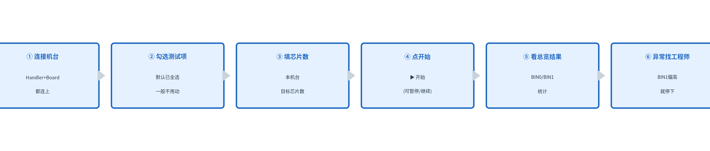

# SLT 上位机软件操作指南（产线工人版）

> 本指南写给产线操作人员，不讲技术原理，只讲"怎么点、怎么看、出问题怎么办"。

---

## 一、启动软件

1. 双击桌面上的 `SLT_Test_Tool.exe`（图标是蓝色 SLT 字样）。
2. 等待窗口打开，会看到 7 个标签页：**总览、机台1 ~ 机台6**。
3. 界面语言默认中文；如需英文，点右上角"语言"下拉框选 English，重启软件生效。

---

## 二、一句话操作流程

---

## 三、连接机台（先做这步）

每个机台有两块连接区：**Handler 控制箱**（管供电/温度）和 **Board 测试板**（管测试）。

| 步骤 | 操作 |
|------|------|
| 1 | 在"类型"下拉框选 **TCP/IP网络**（产线默认网口） |
| 2 | "IP地址"填该机台的 IP（如 192.168.1.101），"TCP端口"保持 5001 |
| 3 | 点绿色 **连接** 按钮 |
| 4 | 按钮旁显示 **● 已连接** 即成功；显示 **● 未连接** 说明没通，见第五节 |

> 提示：连接后"类型"下拉框会锁定，断开后才能再改。

---

## 四、设置并开始测试

### 4.1 勾选测试项

1. 左侧"测试用例"区是折叠的测试项清单，点 ▸ 展开。
2. 默认所有测试项都已勾选，**一般不用动**，直接开始即可。
3. 如需只测某几项：点"全选"全部勾上，或"清空"后手动勾需要的项。
4. **MBIST 是必测项，不能取消。**

### 4.2 填芯片目标数

"本机台芯片目标数"框里填**这一台要测几颗芯片**。例如这台上料 50 颗，就填 50。

### 4.3 开始 / 暂停 / 继续 / 停止

| 按钮 | 用途 |
|------|------|
| ▶ 开始 | 开始测试（从头测，之前的统计清零） |
| ⏸ 暂停 | 暂时停下（如要换料、检查），不会中断 |
| ⏵ 继续 | 从暂停的地方接着测 |
| ■ 停止 | 结束本次测试，没测完的项记为"中止" |

操作要点：
- 测试中按钮下方的"进度条"和"测试中..."会一直更新。
- 每个测试项右侧的"状态"列会显示 运行 / 通过 / 失败 / 中止。
- 测完一颗芯片，结果表会加一行，标着 `Chip1`、`Chip2`…

### 4.4 全部开始 / 全部停止（顶部）

- 想让所有机台一起开始/停止，用顶部两个大按钮，不用一台台点。

---

## 五、看结果

### 5.1 单台结果（机台1~6 标签页）

- **结果表**：每一行是一条测试记录，列有 芯片 / 测试项 / 描述 / 结果 / 错误码。
- **BIN 统计**（结果表下方）：`BIN0-PASS`（通过颗数）、`BIN1-FAIL`（不良颗数）、`BIN2-ABORT`（中止颗数）。

### 5.2 总览（最关心的界面）

点顶部 **总览** 标签页，一行一个机台，一眼看全部：

| 列 | 看什么 |
|----|--------|
| 芯片总数 | 这台已经测完几颗芯片 |
| BIN0 良品 | 通过的好芯片数（绿色） |
| BIN1 不良 | 测坏的不良品数（红色） |
| BIN2 中止 | 中途停掉/异常的（黄色） |
| 状态 | 空闲 / 测试中 / 失败 |

**怎么判断这台好不好**：看 BIN1 不良是不是很多、状态是不是一直"失败"。

### 5.3 全局日志（底部）

底部"全局日志"框记录所有机台的实时动态。出问题时让工程师从这里找线索。
- 日志框边沿可以上下拖动，把窗口调大看得更清楚。

---

## 六、常见问题（出错了怎么办）

| 现象 | 原因 | 处理办法 |
|------|------|---------|
| 点开始弹"请先连接测试板" | Board 没连接 | 回第三节把两块都连上 |
| 连接后显示 ● 未连接 | IP/端口填错或网线不通 | 核对 IP、端口 5001；检查网线 |
| 下拉框点不了 | 已连接，被锁定 | 先点"断开" |
| 界面语言不对 | 上次选了英文 | 右上角选回中文，重启 |
| 测试中途想停又怕浪费 | — | 用 ⏸ 暂停而不是 ■ 停止 |
| 某台状态一直"失败" | 该台良率异常 | 停下该台，喊工程师 |
| 看不到历史日志 | 日志已自动存盘 | 见第七节 |

> 遇到没见过的报错：不要反复点，停下这台机台，找工程师处理。

---

## 七、日志文件在哪里

- 软件每次运行会自动在程序所在的 `logs` 文件夹生成日志文件。
- 文件名类似 `slt_multi_20261019_153000.log`。
- 这些文件是**只读的，删不掉、改不了**，方便留档给工程师排查。
- 日志位置 = 程序运行目录的 `logs` 子文件夹，找 exe 同级的 `logs` 文件夹即可。

---

## 八、安全与规范提醒

1. **换芯片/上料前先点 ⏸ 暂停**，别在测试中途乱动。
2. **别删 logs 文件夹里的日志**，那是留档记录。
3. 测试中电脑**别关机、别拔网线**。
4. 任何异常（机台卡死、结果离谱）先停下，再喊工程师。
5. 下班前：把每台都点 ■ 停止，再正常关闭软件。
