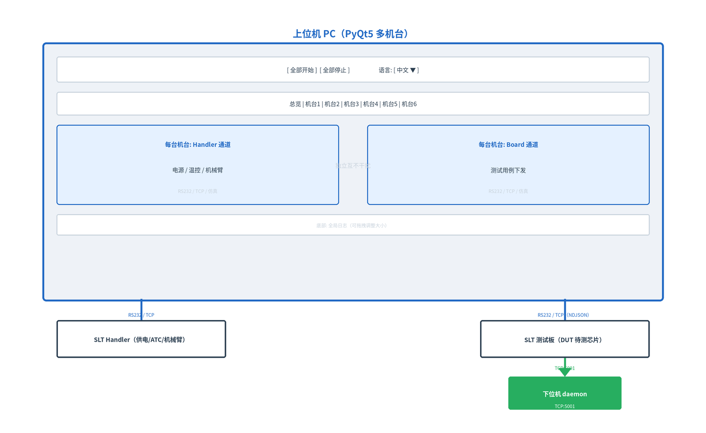
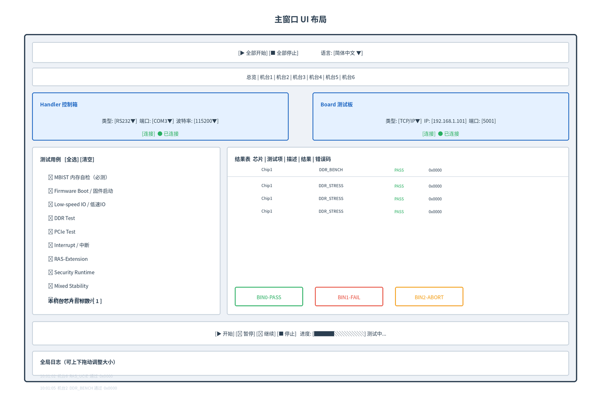

# SLT 多机台上位机软件设计文档

## 1. 概述

本软件为 SLT（System Level Test，系统级测试）上位机工具，用于**同时控制多台测试机台**自动化执行芯片 SLT 测试用例、控制电源/温控设备（Handler）、记录测试结果并按芯片 Bin 分类统计。

**设计原则**：傻瓜式操作 —— 连接 → 选测试项 → 设芯片目标数 → 开始 → 看结果。

**版本特性**：
- **模块化工程结构**（业务逻辑 `app/` 与界面 `ui/*.ui` 分离）
- **界面使用 Qt Designer XML 格式**（`ui/*.ui`），运行时 `uic.loadUi` 加载
- 最多 **6 台机台**（`NUM_STATIONS` 常量可调），每台独立连接、独立测试
- 每台机台两路独立通道：Handler（电源/温控） + Board（测试用例）
- 通信支持 RS232 串口 / TCP/IP 网口 / 仿真 三种模式
- 测试用例树形分组管理，支持折叠，MBIST 为必测项
- 界面支持**中英双语切换**
- 支持每台机台的 **开始 / 暂停 / 继续 / 停止**
- 总览 Dashboard 实时统计每台机台的芯片总数与 BIN 分布

### 工程结构

```
SLT_Tools/
├── run.py                    # 程序入口
├── requirements.txt          # 依赖清单
├── build_windows.bat         # Windows 一键打包
├── ui/                       # Qt Designer 界面 (.ui / XML)
│   ├── main_window.ui        #   主窗口
│   ├── conn_panel.ui         #   连接面板
│   ├── station_panel.ui      #   机台面板
│   └── dashboard.ui          #   总览
└── app/                      # 业务逻辑
    ├── config.py             #   常量配置
    ├── i18n.py               #   中英双语
    ├── test_cases.py         #   测试用例定义
    ├── comm.py               #   通信通道
    ├── worker.py             #   测试线程
    ├── logger.py             #   日志+写保护
    └── ui/                   #   UI 控制器
        ├── main_window.py
        ├── conn_panel.py
        ├── station_panel.py
        └── dashboard.py
```

- 界面布局全部在 `ui/*.ui`（Designer XML）中定义，可用 **Qt Designer** 可视化编辑
- 控制器 `app/ui/*.py` 用 `uic.loadUi()` 加载 `.ui`，控件通过 objectName 直接访问
- 业务逻辑与界面解耦，便于维护与扩展

---

## 2. 系统架构



**多机台连接方式（典型产线部署）：**

| 连接项 | Handler（电源/温控） | Board（测试板） |
|--------|---------------------|----------------|
| 推荐方式 | RS232 串口 / TCP/IP | TCP/IP 网口 |
| TCP 端口 | 可配置 | 默认 5001 |
| 每台机台 | 独立 IP:端口 | 独立 IP:端口 |

> 机台 IP 通常由机台编号分配，例如机台1 → `192.168.1.101`，机台2 → `192.168.1.102`，依此类推。

---

## 3. 通信层设计

### 3.1 CommChannel 类

统一抽象通信通道，三种模式（每台机台 Handler / Board 各一个实例）：

| 模式 | 说明 | 连接参数 |
|------|------|---------|
| 仿真模式 | 无硬件，用于演示/联调 | 无 |
| RS232 串口 | 串口通信 | 串口号 + 波特率（9600~1500000，默认115200） |
| TCP/IP 网络 | 网口通信（NDJSON 协议） | IP 地址 + TCP 端口（默认5001） |

**接口：**

```python
channel.connect_sim()                    # 仿真连接
channel.connect_serial(port, baudrate)    # 串口连接
channel.connect_tcp(ip, port)            # 网口连接
channel.send_cmd(cmd, expect_response)   # 发命令，可选等待回包
channel.run_test_tcp(case_id, progress_cb)  # TCP 下跑一个用例（阻塞）
channel.stop_test_tcp()                  # TCP 下发停止
channel.disconnect()                     # 断开（含优雅关闭）
```

### 3.2 TCP/JSON 协议（Board 通道，真实硬件默认）

帧格式 **NDJSON**：每行一个 JSON 对象，以 `\n` 结尾，UTF-8 编码，端口默认 **5001**。
完整字段定义见 `slt_protocol.md`。核心消息：

| 方向 | 消息类型 | 说明 |
|------|---------|------|
| PC→Board | `TEST_START` | 启动测试用例，携带 `case` |
| PC→Board | `TEST_STOP` | 中止当前用例 |
| PC→Board | `PING` / `GET_STATUS` / `TEST_LIST` | 心跳 / 状态 / 用例列表 |
| Board→PC | `TEST_STARTED` / `TEST_PROGRESS` | 开始 / 进度（pct 0~100） |
| Board→PC | `TEST_DONE` | 结束，携带 `result`(PASS/FAIL)、`err`、`duration_s` |
| Board→PC | `TEST_STOPPED` / `STATUS_RSP` / `ERROR` | 中止 / 状态 / 错误 |

### 3.3 断开保护

- 测试进行中点击"断开"时，先自动停止测试线程并等待退出，再关闭 socket
- socket 采用 `shutdown(SHUT_RDWR)` + `close()` 优雅关闭
- 接收循环对超时/异常兜底，断开后立即返回，不阻塞 UI

---

## 4. 测试用例（树形分组）

测试项以 **分组 + 子项** 树形结构展示，默认全部折叠、默认全部勾选。**MBIST 为必测项。**

| 分组 | 子项 | 优先级 |
|------|------|--------|
| **MBIST 内存自检**（必测） | CCD SOC/HN-F BISR、CCD SOC/HN-F BIST、N3 core BISR、N3 core BIST、PCD BISR、PCD BIST | HIGH |
| **Firmware Boot / 固件启动** | RSS、SCP、MCP、bbl14、bl31、UEFI、secure-firmware、Linux 系统启动 | HIGH |
| **Low-speed IO / 低速IO** | MHU 数据收发、UART 日志、I2C/IPMI SSIF、I3C 读写、eSPI 1/2/4线、GPIO 开关机控制 | HIGH |
| **DDR Test** | 性能基准、并发压力、眼图误码率、ECC、动态功耗、复位测试、子系统交互、时序验证、Burn-in、Re-training、DIMM 兼容、电压裕量 | HIGH |
| **PCIe Test** | 链路训练与状态稳定性、吞吐量与带宽压力、长时间老化、AER 容错、INTx/MSI/MSI-X 压力、ASPM 电源管理、热插拔、寄存器配置与兼容性 | HIGH/MID |
| **Interrupt / 中断** | PPI、SGI、SPI、LPI、GIC 跨die、GIC 跨socket、vSGI、vLPI | HIGH/MID |
| **RAS-Extension** | CMN RAS、GIC RAS、CORE RAS、PCIe/CXL RAS、UCIe RAS、DDR RAS、SMMU RAS | HIGH/MID/LOW |
| **Security Runtime** | 安全运行时检查 | — |
| **Mixed Stability / 混合稳定性** | x265、MySQL、SpecCPU2017、内存压测、CPU 压测、NVMe 压测、混合场景 | MID |
| **Power & Thermal / 功耗热管理** | 温度读取、功耗检查 | — |

> 子项 ID 与下位机 daemon（`slt_board_daemon.py`）中的注册 ID 一一对应，保证下发可执行。

---

## 5. 测试执行流程

### 5.1 单机台流程

```
用户点击 [开始]
   │
   ▼
检查 Board 是否已连接 ── 未连接 → 弹窗提示
   │
   ▼
读取勾选的测试用例 + 本机台芯片目标数 N
   │
   ▼
重置结果表 / Bin 计数 / 进度条 / 测试项状态
   │
   ▼
启动 TestWorker(QThread)，异步执行：
   │
   for chip in 1..N:                 # 每轮 = 测一颗芯片
     for each case:
        ├── 下发 TEST_START 到 Board
        ├── 等待 TEST_PROGRESS / TEST_DONE（含超时）
        ├── 更新测试项状态(运行/通过/失败/中止) 与 结果表
        └── 用户点[暂停]→等待；[继续]→恢复；[停止]→中止
   │
   ▼
关闭本轮 chip Bin（按整轮判定）
   │
   ▼
写日志 → 设置只读保护 → 更新总览 Dashboard
```

### 5.2 控制语义

| 操作 | 行为 |
|------|------|
| 开始 | 从头执行，重置计数 |
| 暂停 | 当前用例执行完后挂起，不中止测试 |
| 继续 | 从暂停处恢复执行 |
| 停止 | 当前用例执行完后中止，剩余用例记为 ABORT |
| 全部开始/全部停止 | 对所有已连接机台批量操作 |

### 5.3 关键点

- 测试在 `QThread` 中执行，不阻塞 UI
- 每台机台独立线程，互不干扰，多机台并行
- 暂停用 `threading.Event` 实现，线程阻塞等待但不销毁
- 停止用标志位，当前用例跑完后退出

---

## 6. 芯片 Bin 分类（总览统计口径）

Bin 按**整颗芯片（一轮循环）**判定：

| Bin | 判定逻辑 | 含义 | 颜色 |
|-----|---------|------|------|
| BIN0 良品 | 该轮所有用例全部 PASS | 通过 | 绿 |
| BIN1 不良 | 该轮存在任意用例 FAIL | 不良 | 红 |
| BIN2 中止 | 该轮中途被停止/异常中止 | 中止 | 黄 |

- 芯片总数 = 已完整结束的轮次数
- 每个机台独立统计，实时推送到总览 Dashboard

---

## 7. 日志与文件记录

### 7.1 输出目录

程序运行时的**当前目录**下 `./logs/`。日志路径跟随运行目录，方便产线收集。

### 7.2 文件命名

| 文件 | 命名格式 | 内容 |
|------|---------|------|
| 全局运行日志 | `slt_multi_YYYYMMDD_HHMMSS.log` | 全部机台的时间戳 + 级别 + 消息 |

### 7.3 写保护

- 测试结束后自动将日志文件权限设为 `444`（只读）
- 关闭文件句柄，防止误删误改
- 新一轮测试自动创建新文件，不写入已保护的旧文件

---

## 8. UI 布局

### 8.1 主窗口



### 8.2 总览 Dashboard

| 机台 | 连接 | 当前测试项 | 芯片总数 | BIN0 良品 | BIN1 不良 | BIN2 中止 | 状态 |
|------|------|-----------|---------|----------|----------|----------|------|

每台机台一行，实时刷新；状态列显示 空闲/测试中/失败。

### 8.3 多语言

- 右上角下拉框切换 简体中文 / English
- 选择写入 `.lang` 文件持久化，重启生效
- `.lang` 位置：exe 同目录（打包后）/ 脚本同目录（源码运行）

---

## 9. 依赖

| 依赖 | 用途 |
|------|------|
| Python 3.8+ | 运行环境 |
| PyQt5 | GUI 框架 |
| pyserial | RS232 串口通信（可选，无串口时自动降级） |

---

## 10. 打包（Windows exe）

见 `build_windows.bat`，关键命令：

```cmd
python -m PyInstaller --noconfirm --windowed --onefile ^
    --name "SLT_Test_Tool" --add-data "ui;ui" run.py
```

- 必须用 `python -m PyInstaller`（环境变量 `pyinstaller` 可能未注册）
- `--add-data "ui;ui"` 必须带上，否则 `.ui` 界面文件未打入 exe 会白屏
- 产物：`dist\SLT_Test_Tool.exe`，单文件无控制台窗口
- 语言文件 `.lang` 在 exe 同目录自动生成

---

## 11. 下位机 daemon（slt_board_daemon.py）

运行于 DUT Linux 板，监听 TCP:5001：

```
python3 slt_board_daemon.py [--port 5001]
```

- 通过 `@register_test("CASE_ID")` 注册测试函数，与上位机用例 ID 一一对应
- 收到 `TEST_START` 后在线程中执行测试函数，`progress_cb` 上报进度
- 支持 `TEST_STOP` 中止（检查 `CURRENT_TEST["stop"]` 标志）
- 内置全部测试项骨架（当前为仿真占位），真实硬件逻辑替换测试函数体即可

---

## 12. 已知边界与约束

| 项 | 说明 |
|----|------|
| 机台数 | 默认 6，改 `NUM_STATIONS` 常量即可增减 |
| 单台并发 | 一台机台同时只能跑一轮测试 |
| 多机台 | 各机台独立线程并行，可同时跑 |
| 结果表 | 每轮按 Chip{序号} 标识芯片，区分不同芯片 |
